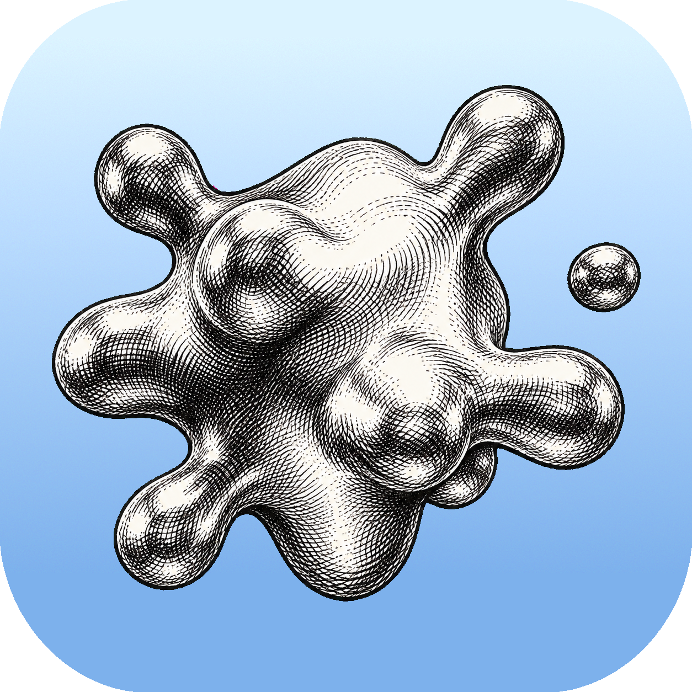
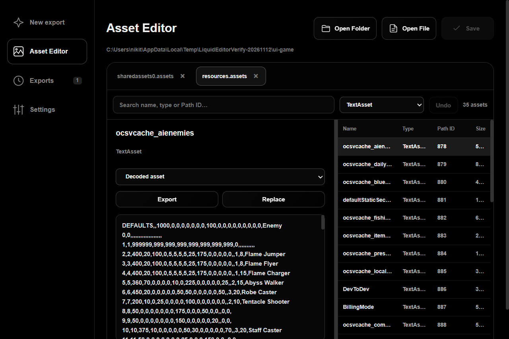
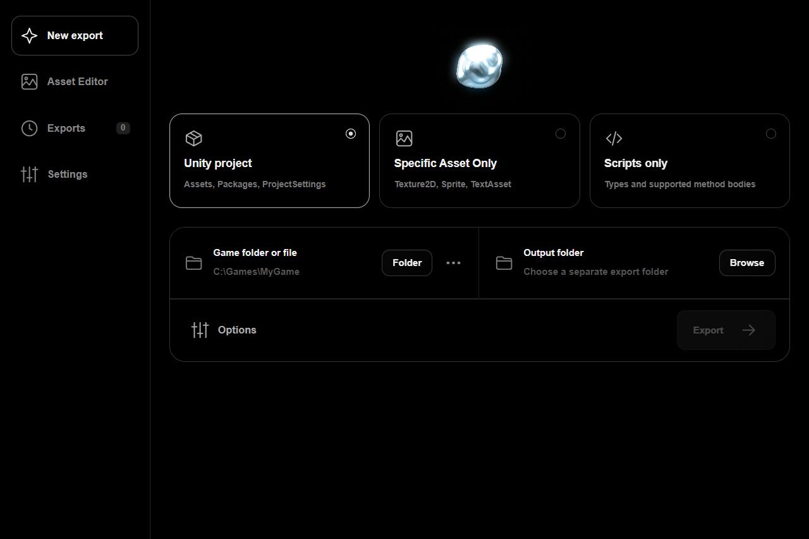

<h1 align="center">Liquid</h1>

Export Unity assets and scripts. Edit game files in one app.

  &nbsp;&nbsp;
  

## Asset Editor

- **Replace a single sprite.** Export it as PNG, edit it, then replace it. Liquid updates that sprite's region in the atlas, so you don't have to edit a huge sprite sheet. Keep the original dimensions.
- **Edit TextAssets directly.** Change text in the preview and press **Save** or **Ctrl+S**. UTF-8 and BOM-marked UTF-16 are supported.
- Preview textures, sprites and audio. Zoom with the wheel, drag to pan, and resize the preview panel.
- Search by name, type or Path ID. Browse the full asset list without pages and switch between Unity files in tabs.
- Export or replace PNGs, text, typed JSON and raw asset data. **Undo** changes before saving.

## Export

| Mode | Output |
| --- | --- |
| **Unity project** | Assets, Packages and ProjectSettings. |
| **Specific Asset Only** | Textures, individual sprites, text, audio, meshes, materials, prefab hierarchies, resources or scripts. |
| **Scripts only** | Reconstructed C# types and supported method bodies, managed assemblies and a recovery report. |

## Run

Download a release ZIP, extract **everything** and run **Liquid.exe**. Requires Windows x64 and WebView2; .NET is included.

In Asset Editor, choose **Open Folder** or **Open File**. **Save** writes changes back to the game files without creating backups. Audio can be previewed/exported; direct WAV replacement is not supported. Script recovery can be incomplete—check `script-report.json`.

English · Русский · Deutsch · Español · Українська · 简体中文 · Français

[Build instructions](docs/BUILD.md) · [Full third-party notices](docs/THIRD-PARTY-NOTICES.md)

## Credits & licenses

Liquid is built on the work of these original authors and contributors:

| Project | Authors | License |
| --- | --- | --- |
| [AssetRipper](https://github.com/AssetRipper/AssetRipper) | AssetRipper contributors | [GPL-3.0](licenses/AssetRipper.txt) |
| [Il2CppDumper](https://github.com/Perfare/Il2CppDumper) | Perfare and contributors | [MIT](licenses/Il2CppDumper.txt) |
| [Cpp2IL](https://github.com/SamboyCoding/Cpp2IL) | Sam Byass (SamboyCoding) and contributors | [MIT](licenses/Cpp2IL.txt) |
| [Ghidra](https://github.com/NationalSecurityAgency/ghidra) | NSA and contributors | [Apache-2.0](https://github.com/NationalSecurityAgency/ghidra/blob/master/LICENSE) |
| [AssetsTools.NET](https://github.com/nesrak1/AssetsTools.NET) / [UABEA](https://github.com/nesrak1/UABEA) | nesrak1 and contributors | [MIT](licenses/AssetsTools.NET.txt) / [MIT](licenses/UABEA.txt) |
| [Fmod5Sharp](https://github.com/SamboyCoding/Fmod5Sharp) | Sam Byass and contributors | [MIT](licenses/Fmod5Sharp.txt) |
| [Argent](https://github.com/seangeng/argent) — visual inspiration | seangeng and contributors | [MIT](https://github.com/seangeng/argent/blob/main/LICENSE) |

Additional libraries & runtimes

| Project | Authors | License |
| --- | --- | --- |
| [ILSpy / ICSharpCode.Decompiler](https://github.com/icsharpcode/ILSpy) | ILSpy contributors | [MIT](https://github.com/icsharpcode/ILSpy/blob/master/LICENSE) |
| [Mono.Cecil](https://github.com/jbevain/cecil) | Jb Evain and contributors | [MIT](https://github.com/jbevain/cecil/blob/master/LICENSE.txt) |
| [Iced](https://github.com/icedland/iced) | iced project and contributors | [MIT](licenses/iced_1.21.0_LICENSE.txt) |
| [TextureDecoder](https://github.com/AssetRipper/TextureDecoder) | ds5678 and contributors | [MIT](licenses/TextureDecoder.txt) |
| [StbImageSharp](https://github.com/StbSharp/StbImageSharp) / [StbImageWriteSharp](https://github.com/StbSharp/StbImageWriteSharp) | StbSharp contributors; original stb by Sean Barrett and contributors | [Public domain / MIT options](licenses/StbSharp.txt) |
| [NAudio](https://github.com/naudio/NAudio) | Mark Heath and contributors | [MIT](licenses/NAudio.txt) |
| [OggVorbisEncoder](https://github.com/SteveLillis/.NET-Ogg-Vorbis-Encoder) | Steve Lillis and contributors | [MIT](licenses/OggVorbisEncoder.txt) |
| [IndexRange](https://github.com/bgrainger/IndexRange) | Bradley Grainger and contributors | [MIT](licenses/IndexRange.txt) |
| [.NET](https://github.com/dotnet/runtime) / [WebView2](https://developer.microsoft.com/microsoft-edge/webview2/) | Microsoft and contributors | [MIT](https://github.com/dotnet/runtime/blob/main/LICENSE.TXT) / [Microsoft terms](licenses/microsoft.web.webview2_1.0.2903.40_LICENSE.txt) |
| [Eclipse Temurin / OpenJDK](https://github.com/adoptium/temurin25-binaries) | Eclipse Adoptium, OpenJDK authors and contributors | [GPL-2.0](https://github.com/adoptium/jdk25u/blob/master/LICENSE) with [Classpath Exception](https://github.com/adoptium/jdk25u/blob/master/ADDITIONAL_LICENSE_INFO) |

Liquid's own code is © 2026 QWU and licensed under [MIT](LICENSE). Third-party components retain their original licenses; their license texts and runtime notices are included in the distribution. See [full notices](docs/THIRD-PARTY-NOTICES.md) for component versions and source links.
